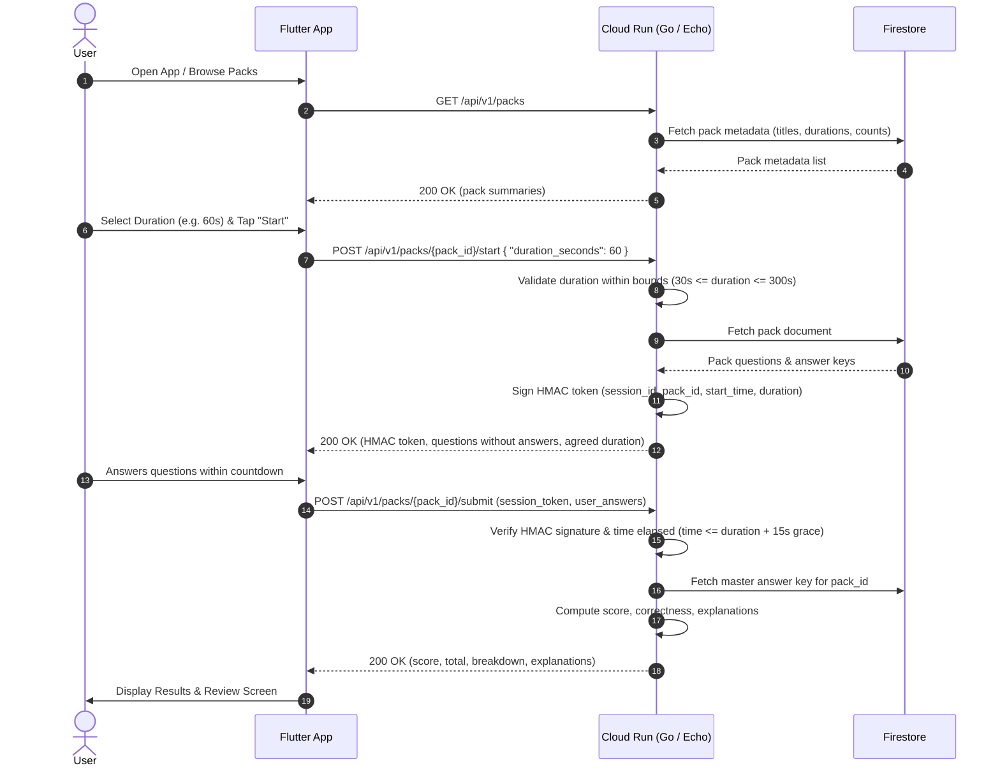

# GK Quiz Mobile Application MVP

* **Author:** engineering-team
* **Status:** In Review
* **Date:** 2025-05-18

---

## Overview

The GK Quiz Mobile Application is a lean, solo trivia experience built with Flutter and Go (Echo framework). It delivers curated, dynamically updated General Knowledge (GK) quiz packs directly to users on iOS and Android without mandatory sign-up walls or account creation. The service is hosted serverlessly on **Cloud Run**, keeping operational maintenance minimal and costs within Google Cloud free tiers while conforming to company engineering standards.

To ensure fair scoring and integrity without requiring user accounts or persistent server databases, sessions are validated using stateless HMAC cryptographic tokens.

## The Problem

Casual mobile quiz players often face high friction upon first launch—including mandatory sign-ups, social media logins, and cluttered ad interfaces—leading to high drop-off rates before the first question is even played. At the same time, client-evaluated quiz games suffer from trivial score tampering, answer inspection via decompiled bundles or HTTP interception, and forged timestamps. Furthermore, fixed timers can frustrate either fast players who want a quick speedrun or casual players who need extra reading time.

We need a streamlined MVP trivia app that allows immediate play within seconds of installation, enables players to choose their own timer pace, maintains tamper-resistant score evaluation, and operates at zero cloud infrastructure cost.

## Goals

* **Zero-Friction Onboarding**: Enable users to start playing a quiz immediately upon opening the app without account registration or sign-in walls.
* **Dynamic Content Delivery**: Deliver 2–3 curated GK quiz packs (e.g., Geography, Science, History) over an API so questions can be added or updated without updating client binaries.
* **Customizable Timer Duration**: Allow users to select their preferred countdown duration (e.g., 60s, 120s, or 180s) before starting a quiz, with server-side validation to enforce safe limits (30s–300s).
* **Tamper-Resistant Scoring**: Ensure answers cannot be inspected beforehand and prevent client-side score modification via server-evaluated sessions validated with stateless HMAC-SHA256 tokens.
* **Serverless Cost-Effective Execution**: Deploy backend handlers on standard company **Cloud Run** (using Go and Echo) and store content in **Firestore** to achieve $0 MVP operating costs within Google Cloud free-tier allocations.

## Non-Goals

* **Multiplayer / Live Battles**: No real-time player matchmaking, 1v1 duels, or synchronous multiplayer.
* **User Accounts & Cloud Sync**: No user profile management, password auth, social login, or multi-device history synchronization.
* **Monetization & Ad Networks**: No in-app purchases (IAP), paywalls, or third-party ad SDK integrations.
* **Offline Quiz Mode**: No offline quiz pack caching or offline answer evaluation; active internet connectivity is required.

## Critical User Journeys (CUJs)

```yaml
- user: Solo Trivia Player
  goals:
  - goal: Discover and play curated GK quiz packs with customizable timer pace
    tasks:
    - task: Browse available quiz packs
      scenario:
        given: The mobile application is installed and connected to the internet
        when: The user launches the application
        then: The app displays 2–3 available GK packs with title, question count, and default timer duration
    - task: Select timer pace and start session
      scenario:
        given: The user is on the pack details screen
        when: The user selects their desired timer pace (e.g., 60s Fast, 120s Standard, or 180s Relaxed) and taps "Start Quiz"
        then: The app requests a session passing the chosen duration; backend validates bounds, returns question prompts (without answers) and a signed HMAC session token, initiating the local countdown
    - task: Play through questions and submit answers
      scenario:
        given: The quiz session is in progress
        when: The user answers all questions or the session timer runs out
        then: The app submits selected answer IDs along with the HMAC session token to the backend for verification
    - task: Review score and correct answer explanations
      scenario:
        given: The backend validates the session token and completion timestamp against the agreed duration
        when: Evaluation completes successfully
        then: The app displays total score, time taken, and an itemized breakdown of questions with correct answers and explanations
```

## Technical Plan (Architecture)

### Plain-Language Concept: What is an HMAC Token? (Business / Non-Technical Overview)

To keep the app completely frictionless, we do not require users to create accounts or log in. However, without accounts, how do we prevent someone from cheating by modifying their score or faking how fast they finished?

Think of an **HMAC token** as a **tamper-evident digital wristband or sealed entry ticket**:
1. **At Quiz Start**: When the user taps "Start", the server issues a small digital ticket containing the quiz ID, the exact start time, and the agreed timer duration (e.g., 120 seconds). Crucially, the server stamps this ticket with an invisible, unforgeable cryptographic seal (`HMAC`) using a secret key only known to the server.
2. **During the Quiz**: The player keeps this sealed ticket on their device while they answer the questions. The answers are stored only on the server, so the player cannot "peek" into the ticket to see the answers.
3. **At Submission**: When the player submits their answers, they return the ticket. The server checks the cryptographic seal. If anyone tried to alter the start time, change the pack ID, or tamper with the duration, the seal breaks and the server rejects the submission. If the seal is intact, the server verifies that `submission_time - start_time` is within the agreed duration plus network grace period.

This provides tamper-resistant session validation and server-enforced time limits without needing databases of user logins or persistent session tables. Note that for the MVP, session analytics are not recorded on the server, and replay protection is scoped strictly to the agreed time window.

### System Architecture Flow

The backend endpoints are implemented as a standard Go service using the Echo framework deployed to containerized **Cloud Run**, providing scale-to-zero economics, low-latency execution, and automatic HTTPS endpoints conforming to platform standards.



### Component Breakdown

1. **Mobile Client (Flutter)**:
   - **Catalog View**: Displays pack cards fetched from `GET /api/v1/packs`.
   - **Timer Pace Selector**: Allows player to choose duration options (e.g., 60s Fast, 120s Standard, 180s Relaxed) on the pack start sheet.
   - **Quiz Runner**: State management holding the active quiz index, selected option IDs, and local countdown timer.
   - **Result Screen**: Renders score percentage, completion time, and an expandable review list with correct answers and educational explanations.
   - **Network Service**: Handles HTTP communication with automatic retry for transient network drops during submission.

2. **Backend API (Cloud Run / Go + Echo)**:
   - Deployed as a lightweight containerized Go service using the Echo framework on Cloud Run, providing instant auto-scaling to zero, sub-500ms cold starts, and minimal memory footprint (< 64MB).
   - **Endpoints**:
     - `GET /api/v1/packs`: Returns list of available quiz packs with metadata (`id`, `title`, `description`, `question_count`, `default_duration_seconds`).
     - `POST /api/v1/packs/{pack_id}/start`: Accepts optional requested `{ "duration_seconds": int }`, clamps between 30 and 300 seconds, signs HMAC token, and returns questions stripped of correct answers.
     - `POST /api/v1/packs/{pack_id}/submit`: Accepts `{ "session_token": str, "answers": { "q1": "opt_b", ... } }`.
   - **In-Memory Pack Cache**:
     - Caches pack metadata and answer keys in-memory with a 5-minute TTL, eliminating repeated Firestore reads on `/start` and `/submit` requests to stay strictly within GCP free-tier quotas (50,000 reads/day).
   - **Security / Token Module**:
     - Token Structure: Base64URL-encoded JSON payload (`session_id`, `pack_id`, `started_at`, `duration_seconds`) joined with its HMAC-SHA256 signature.
     - Stateless validation: Verifies signature with `HMAC_SECRET_KEY`.
     - Timestamp enforcement: Rejects submissions if `current_utc_timestamp - started_at > duration_seconds + 15` (15-second network grace period).
   - **Scoring Engine**:
     - Evaluates submitted answer IDs against the cached authoritative pack data.
     - Compiles itemized report: whether each question was correct, user choice vs. correct choice, and explanation.

3. **Database (Firestore)**:
   - **Collection `packs`**:
     - Document ID: `pack_id` (e.g., `world-geography`, `science-nature`, `history-culture`).
     - Fields:
       - `title`: string
       - `description`: string
       - `default_duration_seconds`: number (e.g., 120)
       - `questions`: array of maps containing:
         - `id`: string
         - `prompt`: string
         - `options`: array of maps `{ "id": string, "text": string }`
         - `correct_option_id`: string
         - `explanation`: string

## Alternatives Considered

### Alternative A: Client-Side Answer Evaluation (Bundled Assets)

* **Pros**:
  - Full offline capability; zero backend infrastructure and operational cost.
  - Sub-millisecond question and result transitions.
* **Cons**:
  - Trivial to inspect answers by decompiling app assets or monitoring memory.
  - Adding or modifying quiz packs requires releasing and distributing a new app version through app stores.
  - Impossible to verify session timestamps or prevent automated score inflation.
* **Reason for Rejection**: Fails the core project goals of dynamic content management and tamper-resistant score evaluation.

### Alternative B: Stateful Server-Side Sessions with Redis / Firestore Session Documents

* **Pros**:
  - Enables server-side cancellation or single-use invalidation of active sessions.
  - Easy to query active in-flight quizzes.
* **Cons**:
  - Redis (Cloud Memorystore) introduces a continuous baseline cloud cost ($30+/month), violating the $0 free-tier target.
  - Storing sessions in Firestore requires additional document writes and reads per quiz attempt, rapidly consuming free-tier limits.
  - Adds session state synchronization complexity across instances.
* **Reason for Rejection**: Excessive operational complexity and cost for an MVP. Stateless HMAC tokens provide equivalent tamper resistance and time-window enforcement without persistent storage overhead.

### Alternative C: Python / Cloud Run Functions vs. Go + Echo on Cloud Run

* **Pros of Python / Cloud Run Functions**: Rapid single-file scripting, no initial Dockerfile configuration.
* **Cons of Python / Cloud Run Functions**: Higher cold-start latency compared to compiled Go binaries, diverges from company engineering standards (Golang, Echo, Cloud Run), and fragments backend tooling and CI/CD pipelines.
* **Why Go + Echo on Cloud Run is Chosen**: Strictly aligns with standard company platform infrastructure, delivers compiled binary efficiency with sub-500ms cold starts, and integrates into the standard corporate Docker build and Cloud Run deployment workflows.

## Risks & Mitigations

* **Risk 1: Client Submission Drop and Exceeded Grace Period**
  - *Failure Mode*: On degraded cellular connections, exponential backoff retries may push final HTTP receipt past the 15-second grace window (`started_at + duration_seconds + 15s`), resulting in an expired session error (`400 Bad Request`).
  - *Mitigation*: The mobile client schedules early submission triggers at 0 seconds remaining and caps retry delays to 2s and 4s (totaling < 7s of delay), well within the 15-second grace budget. If expired, the client surfaces an informative network timeout dialog allowing the user to restart without crashing.

* **Risk 2: Free-Tier Firestore Read Quota Exhaustion**
  - *Scalability Boundary*: GCP free tier permits 50,000 document reads per day. Without caching, high traffic on 2–3 packs could deplete daily read limits.
  - *Mitigation*: Pack documents and answer keys are cached in-memory within Go process memory with a 5-minute TTL. Active Cloud Run instances serve start and submit requests from local RAM, reducing Firestore reads to near zero during steady-state traffic.

* **Risk 3: Answer Key Harvesting via Instant Replay**
  - *Failure Mode*: Because session tokens are stateless without persistent single-use flags, a user could submit blank answers immediately after starting to obtain the answer key and explanations in the response payload.
  - *Mitigation*: In MVP, results are purely displayed locally on device with no public leaderboards or competitive ranking stakes. For post-MVP competitive modes, single-use token consumption will be enforced via low-cost ephemeral tracking (e.g., Firestore transactions or Redis token markers).

* **Risk 4: Cloud Run Cold Starts & Latency Spikes**
  - *Failure Mode*: Scaling from zero may introduce a 200–500ms initial latency spike for new instances.
  - *Mitigation*: The Go Echo binary compiles to a static, lightweight image (< 20 MB) with no heavy reflection or runtime initialization, keeping cold starts reliably under 500ms.

* **Security & Privacy**:
  - Server secrets (`HMAC_SECRET_KEY`) are managed via Secret Manager or Cloud Run environment variables and never committed to source control.
  - No Personally Identifiable Information (PII) is captured, stored, or transmitted.

---

## Detailed Implementation Plan

### Target Files to Create/Modify

#### 1. `backend/go.mod` & `backend/go.sum` (Create)
* **Type / Scope**: Go module manifest.
* **Proposed Changes**: Declare dependencies conforming to corporate standard: `github.com/labstack/echo/v4`, `cloud.google.com/go/firestore`, `github.com/google/uuid`, and `github.com/stretchr/testify`.

#### 2. `backend/models/quiz.go` (Create)
* **Type / Scope**: Go domain data models.
* **Proposed Changes**: Define Go structs with JSON tags:
  - `Option`: `ID string`, `Text string`.
  - `QuestionPublic`: `ID string`, `Prompt string`, `Options []Option`.
  - `QuestionDetail`: `ID string`, `Prompt string`, `Options []Option`, `CorrectOptionID string`, `Explanation string`.
  - `PackSummary`: `ID string`, `Title string`, `Description string`, `QuestionCount int`, `DefaultDurationSeconds int`.
  - `PackDetail`: `ID string`, `Title string`, `Description string`, `DefaultDurationSeconds int`, `Questions []QuestionDetail`.
  - `SessionPayload`: `SessionID string`, `PackID string`, `StartedAt int64`, `DurationSeconds int`.
  - `StartQuizRequest`: `DurationSeconds *int`.
  - `StartQuizResponse`: `SessionToken string`, `PackID string`, `DurationSeconds int`, `Questions []QuestionPublic`.
  - `SubmitQuizRequest`: `SessionToken string`, `Answers map[string]string`.
  - `QuestionReviewItem`: `QuestionID string`, `IsCorrect bool`, `SelectedOptionID *string`, `CorrectOptionID string`, `Explanation string`.
  - `SubmitQuizResponse`: `Score int`, `Total int`, `Percentage float64`, `ElapsedSeconds int`, `Breakdown []QuestionReviewItem`.

#### 3. `backend/auth/token.go` (Create)
* **Type / Scope**: Cryptographic token management.
* **Proposed Changes**:
  - `CreateSessionToken(packID string, durationSeconds int, secret string) (string, error)`: Builds JSON payload with `session_id` (UUIDv4), `pack_id`, `started_at` (Unix UTC timestamp), and `duration_seconds`. Signs payload using HMAC-SHA256, returning `base64url(payload).base64url(sig)`.
  - `VerifySessionToken(token string, secret string, gracePeriodSeconds int) (bool, *SessionPayload, string)`: Verifies HMAC signature, parses JSON payload, and verifies that `now - started_at <= duration_seconds + gracePeriodSeconds`.

#### 4. `backend/db/firestore.go` (Create)
* **Type / Scope**: Firestore data access module.
* **Proposed Changes**:
  - `NewFirestoreClient(ctx context.Context) (*firestore.Client, error)`: Initializes Firestore client.
  - `FetchAllPackSummaries(ctx context.Context, client *firestore.Client) ([]PackSummary, error)`: Retrieves pack summaries projection.
  - `FetchPackByID(ctx context.Context, client *firestore.Client, packID string) (*PackDetail, error)`: Retrieves full pack document including answer keys.

#### 5. `backend/main.go` & `backend/Dockerfile` (Create)
* **Type / Scope**: Go Echo server entry point and container definition.
* **Proposed Changes**:
  - Setup Echo web server with CORS, logging, and recover middleware.
  - Routes:
    - `GET /api/v1/packs`: Returns summaries from `FetchAllPackSummaries`.
    - `POST /api/v1/packs/:pack_id/start`: Validates requested `duration_seconds` (clamping between 30 and 300 seconds), issues HMAC session token via `CreateSessionToken`, and returns questions stripped of correct answers.
    - `POST /api/v1/packs/:pack_id/submit`: Verifies token authenticity and timestamp via `VerifySessionToken`. Evaluates submitted answers against master keys, computing score, total, percentage, and review items.
  - Multi-stage `Dockerfile`: Compiles static Go binary via `golang:1.22-alpine` builder and runs on lightweight `alpine` / `distroless` image for deployment on Cloud Run.

#### 6. `backend/cmd/seed/main.go` (Create)
* **Type / Scope**: Database seed CLI tool.
* **Proposed Changes**:
  - Populate 3 initial GK packs into Firestore collection `packs`:
    1. `world-geography`: 10 questions on capitals, landforms, and borders.
    2. `science-nature`: 10 questions on physics, biology, and astronomy.
    3. `history-culture`: 10 questions on world heritage, historical milestones, and art.
  - Ensures atomic idempotency via Firestore `Set(ctx, ..., firestore.MergeAll)`.

#### 7. `backend/main_test.go` & `backend/auth/token_test.go` (Create)
* **Type / Scope**: Automated unit and API test suite (standard `testing` + `testify`).
* **Proposed Changes**:
  - Test valid token signing and verification.
  - Test tampering rejection (modified payload, altered duration, invalid signature).
  - Test expired submission rejection (submission time beyond duration + 15s grace).
  - Test duration clamping (requesting 5s clamps to 30s; requesting 999s clamps to 300s).
  - Test score evaluation (perfect score, partial score, empty answers, invalid question IDs).

#### 8. `mobile/pubspec.yaml` (Create/Modify)
* **Type / Scope**: Flutter package manifest.
* **Proposed Changes**:
  - Declare dependencies: `flutter`, `http: ^1.2.0`, `provider: ^6.1.1`.
  - Declare dev dependencies: `flutter_test`, `flutter_lints: ^3.0.0`.

#### 9. `mobile/lib/models/quiz_models.dart` (Create)
* **Type / Scope**: Dart data models.
* **Proposed Changes**:
  - Implement Dart classes with `fromJson` / `toJson` deserializers matching backend API contracts: `QuizPack`, `Question`, `Option`, `QuizSessionStart`, `SubmitPayload`, `QuizResult`, `ReviewItem`.

#### 10. `mobile/lib/services/api_service.dart` (Create)
* **Type / Scope**: Flutter HTTP network service.
* **Proposed Changes**:
  - Configurable `baseUrl` targeting Cloud Run service URL.
  - `Future<List<QuizPack>> getPacks()`: Fetches quiz pack catalog.
  - `Future<QuizSessionStart> startQuiz(String packId, int durationSeconds)`: Initiates session.
  - `Future<QuizResult> submitQuiz(String packId, String sessionToken, Map<String, String> answers)`: Submits responses with automatic retry (up to 2 retries with exponential backoff on network drop).

#### 11. `mobile/lib/controllers/quiz_controller.dart` (Create)
* **Type / Scope**: Flutter state controller (`ChangeNotifier`).
* **Proposed Changes**:
  - State variables: `List<QuizPack> packs`, `QuizPack? selectedPack`, `int selectedDuration`, `int remainingSeconds`, `int currentQuestionIndex`, `Map<String, String> userAnswers`, `QuizResult? result`, `bool isSubmitting`.
  - Methods: `loadCatalog()`, `selectPack(QuizPack pack)`, `setDuration(int seconds)`, `startQuiz()`, `selectAnswer(String questionId, String optionId)`, `nextQuestion()`, `previousQuestion()`, `tick()`, `submitCurrentQuiz()`.
  - Countdown timer logic: Triggers `submitCurrentQuiz()` automatically when `remainingSeconds == 0`.

#### 12. `mobile/lib/screens/catalog_screen.dart` (Create)
* **Type / Scope**: Flutter UI Screen.
* **Proposed Changes**:
  - Displays grid/list of 2–3 quiz pack cards showing title, description, and question count.
  - Tapping a card opens a bottom modal sheet allowing user to pick their timer pace (e.g. 60s Fast, 120s Standard, 180s Relaxed) before tapping "Start Quiz".

#### 13. `mobile/lib/screens/quiz_screen.dart` (Create)
* **Type / Scope**: Flutter UI Screen.
* **Proposed Changes**:
  - Top bar: Visual linear countdown progress bar + numeric timer display with warning colors as time runs low (< 15s).
  - Question card: Displays question text and 4 selectable option tiles.
  - Bottom navigation: "Previous", "Next", and "Submit" buttons.

#### 14. `mobile/lib/screens/result_screen.dart` (Create)
* **Type / Scope**: Flutter UI Screen.
* **Proposed Changes**:
  - Header: Score circle indicator (e.g., 8/10, 80%), completion time, and congratulatory feedback text.
  - Review list: Expandable list showing all questions, indicating user's answer, correct answer, and explanation.
  - Action button: "Play Another Pack" returning to `CatalogScreen`.

#### 15. `mobile/lib/main.dart` (Create)
* **Type / Scope**: Flutter Application Entry Point.
* **Proposed Changes**:
  - Setup `MaterialApp` with clean, modern quiz theme, multi-provider bindings, and route navigation (`/`, `/quiz`, `/result`).

#### 16. `mobile/test/widget_test.dart` (Create/Modify)
* **Type / Scope**: Flutter automated widget & unit tests.
* **Proposed Changes**:
  - Test pack list rendering on `CatalogScreen`.
  - Test duration pace picker selection.
  - Test option selection and question navigation on `QuizScreen`.
  - Test timer countdown tick and auto-submit trigger on expiration.
  - Test score and explanation display on `ResultScreen`.

#### 17. `README.md` (Modify)
* **Type / Scope**: Project documentation.
* **Proposed Changes**:
  - Document local development instructions for Flutter (`flutter run`).
  - Document Cloud Run deployment command (`gcloud run deploy gk-quiz-api ...`).
  - Document database seeding instructions (`go run backend/cmd/seed/main.go`).

---

### Unified Implementation Steps

1. **Phase 1: Backend Foundation & Data Seeding**
   - Setup `backend/go.mod` and install dependencies.
   - Implement `backend/models/quiz.go` with Go struct request/response definitions.
   - Implement `backend/auth/token.go` with HMAC-SHA256 signing and expiration checks.
   - Implement `backend/db/firestore.go` for Firestore operations.
   - Create `backend/cmd/seed/main.go` and populate the 3 curated GK packs into Firestore.
   - Implement `backend/main.go` routing the 3 endpoints via Echo, and provide `backend/Dockerfile`.
   - Execute test suite via `go test ./... -v` to verify 100% token security, timer bounds, and scoring logic.

2. **Phase 2: Mobile Client Architecture & State**
   - Update `mobile/pubspec.yaml` with HTTP and state management dependencies.
   - Implement `mobile/lib/models/quiz_models.dart`.
   - Implement `mobile/lib/services/api_service.dart` with network retry logic.
   - Implement `mobile/lib/controllers/quiz_controller.dart` managing timer ticker, pack selection, and answer map.

3. **Phase 3: Mobile UI Screens & Navigation**
   - Implement `mobile/lib/screens/catalog_screen.dart` with duration bottom sheet.
   - Implement `mobile/lib/screens/quiz_screen.dart` with animated countdown bar and option tiles.
   - Implement `mobile/lib/screens/result_screen.dart` with review breakdowns.
   - Wire application entry point in `mobile/lib/main.dart`.

4. **Phase 4: Automated Testing, Deployment & Verification**
   - Run Flutter unit and widget tests (`flutter test`).
   - Deploy backend container to Cloud Run with environment secrets.
   - Run end-to-end integration test validating a complete quiz run on mobile against deployed Cloud Run service.
   - Update `README.md` with complete operator setup guides.

---

### Verification Plan

* **Dependency Updates & Hygiene**:
  - Go: `go list -m all && govulncheck ./...` (verify zero known vulnerabilities).
  - Flutter: `flutter pub get && flutter pub outdated`.
* **Static Analysis & Linting**:
  - Go: `golangci-lint run ./...` and `go vet ./...`.
  - Flutter: `flutter analyze`.
* **Unit & Integration Tests**:
  - Backend: `go test -v -race -cover ./...` (Require >= 90% coverage on auth and scoring).
  - Mobile: `flutter test --coverage` (Ensure widget selection and timer expiration paths pass).
* **Compilation & Build**:
  - Mobile: `flutter build apk --debug` and `flutter build ios --no-codesign` to verify clean builds.
  - Backend: `docker build -t gk-quiz-api backend/` and Cloud Run deployment dry-run (`gcloud run deploy gk-quiz-api --image=... --dry-run`).
* **E2E Smoke Verification**:
  - Launch app -> load packs -> pick 60s timer -> answer 10 questions -> submit -> verify results, correct score, and explanations render within 2 seconds.

---

### Future Improvements

* **Global Leaderboards**: Post-MVP anonymous high-score leaderboards using device identifier hashes or optional display names.
* **Offline Pack Mode**: Encrypted local pack storage with delayed batch score sync for offline flights/commutes.
* **Multiplayer Trivia Showdown**: Synchronous turn-based or real-time quiz battles using WebSockets / Cloud PubSub.

---

### Open Questions

* **Firestore Region Configuration**: Confirm target GCP project region (e.g., `us-central1` or `europe-west1`) for co-locating Cloud Run and Firestore to minimize latency.
