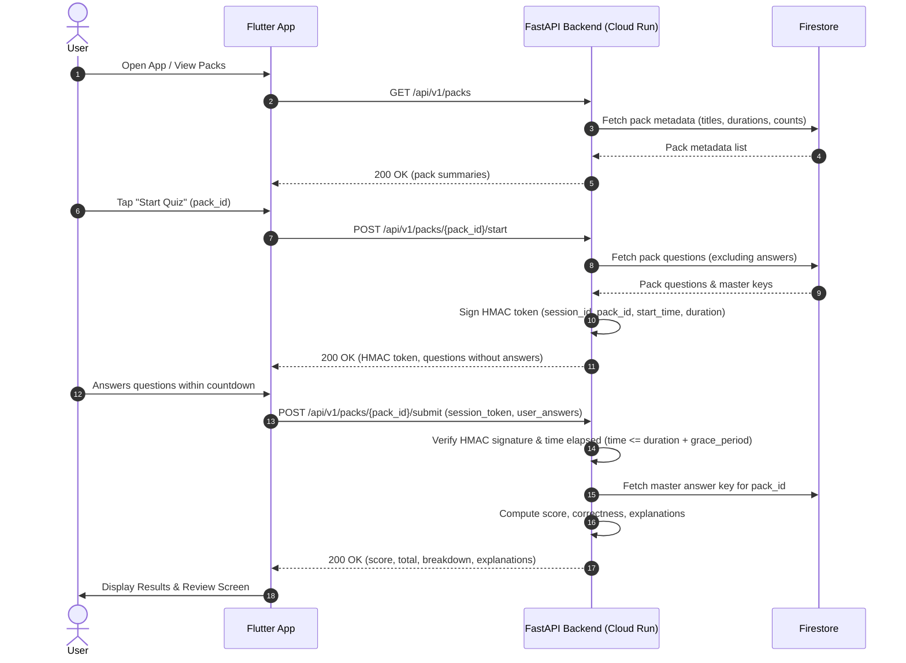

# GK Quiz Mobile Application MVP

* **Author:** engineering-team
* **Status:** Draft
* **Date:** 2025-05-18

---

## Overview

The GK Quiz Mobile Application is a lean, solo trivia experience built with Flutter and Python (FastAPI). It delivers curated, dynamically updated General Knowledge (GK) quiz packs directly to users on iOS and Android without mandatory sign-up walls or account creation. The design guarantees fair scoring through server-evaluated sessions secured by stateless HMAC cryptographic tokens.

## The Problem

Casual mobile quiz players often face high friction upon first launch—including mandatory sign-ups, social media logins, and cluttered ad interfaces—leading to high drop-off rates before the first question is even played. At the same time, client-evaluated quiz games suffer from trivial score tampering, answer inspection via decompiled bundles or HTTP interception, and forged timestamps.

We need a streamlined MVP trivia app that allows immediate play within seconds of installation while maintaining tamper-resistant score evaluation and zero ongoing server maintenance or database synchronization overhead.

## Goals

* **Zero-Friction Onboarding**: Enable users to start playing a quiz immediately upon opening the app without account registration or sign-in walls.
* **Dynamic Content Delivery**: Deliver 2–3 curated GK quiz packs (e.g., Geography, Science, History) over an API so questions can be added or updated without updating client binaries.
* **Tamper-Resistant Scoring**: Ensure answers cannot be inspected beforehand and prevent client-side score modification via server-evaluated sessions validated with stateless HMAC-SHA256 tokens.
* **Cost-Effective Scalability**: Deploy on Cloud Run and Firestore to ensure $0 MVP operating costs within Google Cloud free-tier allocations.

## Non-Goals

* **Multiplayer / Live Battles**: No real-time player matchmaking, 1v1 duels, or synchronous multiplayer.
* **User Accounts & Cloud Sync**: No user profile management, password auth, social login, or multi-device history synchronization.
* **Monetization & Ad Networks**: No in-app purchases (IAP), paywalls, or third-party ad SDK integrations.
* **Offline Quiz Mode**: No offline quiz pack caching or offline answer evaluation; active internet connectivity is required.

## Critical User Journeys (CUJs)

```yaml
- user: Solo Trivia Player
  goals:
  - goal: Discover and play curated GK quiz packs without account registration
    tasks:
    - task: Browse available quiz packs
      scenario:
        given: The mobile application is installed and connected to the internet
        when: The user launches the application
        then: The app displays 2–3 available GK packs with title, question count, and estimated time limit
    - task: Start a quiz session
      scenario:
        given: The user is on the pack catalog screen
        when: The user selects a pack and taps "Start Quiz"
        then: The app requests a session from the backend, receiving question prompts and choices (without answers) and a signed HMAC session token, initiating a countdown timer
    - task: Play through questions and submit answers
      scenario:
        given: The quiz session is in progress
        when: The user answers all questions or the session timer runs out
        then: The app submits selected answer IDs along with the HMAC session token to the backend for verification
    - task: Review score and correct answer explanations
      scenario:
        given: The backend validates the session token and completion timestamp
        when: Evaluation completes successfully
        then: The app displays total score, time taken, and an itemized breakdown of questions with correct answers and explanations
```

## Technical Plan (Architecture)

### Architectural Overview

The architecture follows a clean client-server model separating client-side presentation and session timing from server-side content storage, token validation, and scoring.



### Component Breakdown

1. **Mobile Client (Flutter)**:
   - **Catalog View**: Displays pack cards fetched from `GET /api/v1/packs`.
   - **Quiz Runner**: State management holding the active quiz index, selected option IDs, and local countdown timer. Questions display prompt text and 4 multiple-choice options.
   - **Result Screen**: Renders score percentage, completion time, and an expandable review list with correct answers and educational explanations.
   - **Network Service**: Handles HTTP communication with automatic retry for transient network drops during submission.

2. **Backend API (Python / FastAPI on Cloud Run)**:
   - **Endpoints**:
     - `GET /api/v1/packs`: Returns list of available quiz packs with metadata (`id`, `title`, `description`, `question_count`, `duration_seconds`).
     - `POST /api/v1/packs/{pack_id}/start`: Generates session ID and UTC start timestamp, computes HMAC-SHA256 signature, and responds with the signed token and question list (excluding answers).
     - `POST /api/v1/packs/{pack_id}/submit`: Accepts `{ "session_token": str, "answers": { "q1": "opt_b", ... } }`.
   - **Security / Token Module**:
     - Token Structure: Base64URL-encoded JSON payload (`session_id`, `pack_id`, `started_at`, `duration_seconds`) joined with its HMAC-SHA256 signature.
     - Stateless validation: Verifies signature with `HMAC_SECRET_KEY`.
     - Timestamp enforcement: Rejects submissions if `current_utc_timestamp - started_at > duration_seconds + 15` (15-second network grace period).
   - **Scoring Engine**:
     - Evaluates submitted answer IDs against the authoritative pack data stored in Firestore.
     - Compiles itemized report: whether each question was correct, user choice vs. correct choice, and explanation.

3. **Database (Firestore)**:
   - **Collection `packs`**:
     - Document ID: `pack_id` (e.g., `world-geography`, `science-nature`, `history-culture`).
     - Fields:
       - `title`: string
       - `description`: string
       - `duration_seconds`: number (e.g., 120)
       - `questions`: array of maps containing:
         - `id`: string
         - `prompt`: string
         - `options`: array of maps `{ "id": string, "text": string }`
         - `correct_option_id`: string
         - `explanation`: string

## Alternatives Considered

### Alternative A: Client-Side Answer Evaluation (Bundled Assets)

* **Pros**:
  - Full offline capability; zero backend infrastructure and operational cost.
  - Sub-millisecond question and result transitions.
* **Cons**:
  - Trivial to inspect answers by decompiling app assets or monitoring memory.
  - Adding or modifying quiz packs requires releasing and distributing a new app version through app stores.
  - Impossible to verify session timestamps or prevent automated score inflation.
* **Reason for Rejection**: Fails the core project goals of dynamic content management and tamper-resistant score evaluation.

### Alternative B: Stateful Server-Side Sessions with Redis / Firestore Session Documents

* **Pros**:
  - Enables server-side cancellation or single-use invalidation of active sessions.
  - Easy to query active in-flight quizzes.
* **Cons**:
  - Redis (Cloud Memorystore) introduces a continuous baseline cloud cost ($30+/month), violating the $0 free-tier target.
  - Storing sessions in Firestore requires additional document writes and reads per quiz attempt, rapidly consuming free-tier limits.
  - Adds session state synchronization complexity across Cloud Run container instances.
* **Reason for Rejection**: Excessive operational complexity and cost for an MVP. Stateless HMAC tokens provide equivalent tamper resistance and time-window enforcement without persistent storage overhead.

### Alternative C: Go (Echo) Backend Service

* **Pros**:
  - Follows corporate infrastructure recommendations.
  - Lower memory footprint and slightly faster cold-start times on Cloud Run.
* **Cons**:
  - Requires writing more boilerplate for request validation and serialization.
  - FastAPI was specifically chosen for team velocity and native Pydantic schema validation.
* **Reason for Rejection**: The cold-start difference (< 1s) and memory usage of a lean FastAPI service are well within free-tier limits, and team familiarity ensures a faster 2–3 week delivery.

## Non-Functional Requirements related to a critical risk

* **Security & Privacy**:
  - Stateless HMAC-SHA256 tokens prevent tampering with session timestamps or pack identifiers.
  - Answer keys are never sent to the client during the active quiz session.
  - Server secrets (`HMAC_SECRET_KEY`) are managed via Cloud Run environment secrets and never committed to source control.
  - No Personally Identifiable Information (PII) is captured, stored, or transmitted.
* **Performance & Latency**:
  - Cloud Run container image optimized for minimal cold-start times (< 1.5s).
  - Lightweight JSON payloads (< 20 KB per quiz pack) ensuring smooth operation even on limited mobile data connections.
* **Resilience & Rollout**:
  - 15-second submission grace period accommodates mobile network latency and edge-of-cell reconnects.
  - Stateless architecture allows zero-downtime updates and seamless blue/green deployments on Cloud Run.
