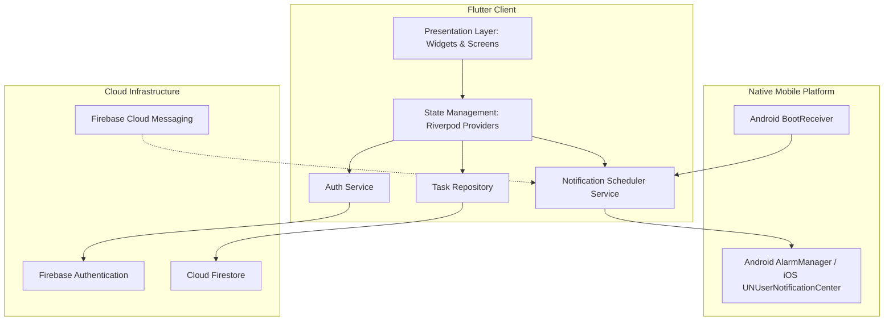
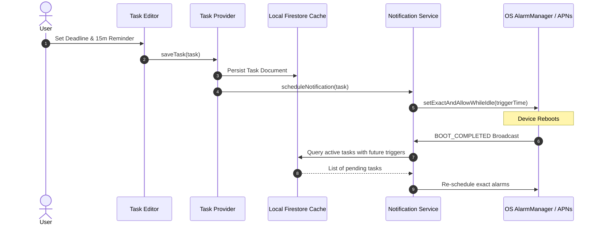

# Todo Mobile Application

*   **Author:** Mobile Engineering Team
*   **Status:** In Review
*   **Date:** 2025-05-18

--------------------------------------------------------------------------------

## Overview

The Todo Mobile Application is a mobile-first task management application built with Flutter, designed to help individuals capture, structure, and track tasks reliably across iOS and Android. The application emphasizes immediate access and high reliability through an offline-first architecture, an instant Guest Mode that defers authentication, granular check-pointed subtasks, and exact-alarm local notifications that fire regardless of network connectivity or operating system background throttling. When connected, tasks synchronize seamlessly across devices via Cloud Firestore.

## The Problem

Modern task management applications frequently fail users in high-mobility and low-connectivity environments:

1. **Connectivity Dependencies**: Cloud-reliant apps fail to load or accept input in offline scenarios (such as transit, remote areas, or flight mode). Furthermore, remote push notifications (FCM/APNs) fail to trigger deadline alerts when a device is offline.
2. **Onboarding Friction**: Forcing immediate registration and account creation introduces high drop-off before users experience the app's core utility.
3. **Fragile Local Solutions**: Local-only task apps protect privacy and operate offline, but lack data durability; users risk catastrophic data loss on device replacement, loss, or factory reset.
4. **Monolithic Task Representation**: Basic todo apps lack structured breakdown mechanisms, forcing users to clutter main task lists with micro-items or track intermediate sub-steps externally.
5. **Notification Unreliability**: Mobile operating systems (Android Doze, iOS background execution restrictions) aggressively throttle standard background tasks, causing missed deadlines unless exact system alarm APIs and reboot recovery mechanisms are utilized.

The Todo Mobile Application addresses these problems by offering zero-friction instant onboarding in Guest Mode, offline-first local persistence, check-pointed subtask checklists, and exact hardware-level notifications, backed by seamless cloud sync and account linking.

## Goals

* **Instant Guest Onboarding**: Allow users to immediately launch the app and create tasks without an initial signup or authentication barrier.
* **Offline-First Persistence**: Ensure 100% of task operations (create, read, update, delete, complete, and archive) work seamlessly without an active internet connection.
* **Structured Subtask Checkpoints**: Enable users to break down complex tasks into ordered subtask checklists with live visual progress indicators (e.g., "3 of 5 completed").
* **Reliable Offline Deadline Reminders**: Provide exact, local deadline notifications with user-configurable lead times (e.g., at deadline, 15 minutes before, 60 minutes before) that fire reliably offline and persist across device reboots.
* **Decluttering via Task Archiving**: Allow users to archive completed or inactive tasks to preserve historical records while keeping the primary workspace focused.
* **Seamless Cloud Synchronization & Account Linking**: Automatically sync tasks to Cloud Firestore when online, allowing guest users to link their session to an authenticated identity (Email/Password or Social OAuth) with zero data loss.

## Non-Goals

* **Collaboration & Shared Boards**: No multi-user shared task boards, team assignments, or collaborative editing in the MVP.
* **Advanced Recurring Scheduling**: No support for complex recurring recurrence rules (RRULE patterns, e.g., "every second Tuesday of the month").
* **Natural Language Processing (NLP)**: No natural language input parsing for automated date/priority extraction (e.g., "Buy groceries tomorrow at 5pm").
* **Web and Desktop Targets**: Deployment is strictly focused on native mobile targets (iOS and Android); web and desktop clients are out of scope for the MVP.
* **Deeply Nested Task Hierarchies**: Subtasks are restricted to a single-level checklist; recursive parent-child task nesting is not supported.

## Critical User Journeys (CUJs)

```yaml
- user: Individual Mobile User
  goals:
  - goal: Onboard and capture urgent tasks without friction
    tasks:
    - task: Instant guest access and task creation
      scenario:
        given: A newly installed application opened for the first time without an existing account.
        when: The user launches the app and creates a High-priority task with a due date and a 60-minute advance reminder.
        then: The task is saved locally immediately in Guest Mode, and an exact local alarm is scheduled without prompting for signup.
    - task: Subtask breakdown and progress tracking
      scenario:
        given: An active parent task with multiple action items.
        when: The user adds three subtasks and marks two of them as completed.
        then: The subtasks persist in order, and the parent task displays a visual progress indicator reflecting "2 of 3 completed".
  - goal: Manage active task decluttering and lifecycle
    tasks:
    - task: Archiving and unarchiving tasks
      scenario:
        given: A finished or deferred task present on the active dashboard.
        when: The user executes an archive action on the task.
        then: The task is removed from the active view, placed in the dedicated Archive view, and can later be unarchived back to active status without data loss.
  - goal: Retain data and access tasks across devices
    tasks:
    - task: Seamless guest account linking
      scenario:
        given: A guest user with existing local tasks who wants to enable multi-device sync.
        when: The user navigates to Settings and completes account linking using Google Sign-In or Email/Password.
        then: All existing guest tasks and subtasks are associated with the authenticated account in Cloud Firestore with zero data loss.
    - task: Timely deadline alert delivery in offline mode
      scenario:
        given: A scheduled task with a reminder set 15 minutes prior to the deadline, with device offline and app killed.
        when: The scheduled alert time arrives.
        then: The operating system triggers an exact local notification banner; tapping it launches the app directly into the task details screen.
    - task: Multi-device state synchronization
      scenario:
        given: An authenticated user with the app installed on two devices (Device A and Device B).
        when: The user completes a subtask and archives a task on Device A while offline, then Device A reconnects.
        then: Changes synchronize to Cloud Firestore using Last-Write-Wins (LWW), and Device B updates its list and cancels any associated obsolete alarms.
```

--------------------------------------------------------------------------------

## Technical Plan (Architecture)

### 1. High-Level System Architecture

The application is structured into four primary layers:
1. **Presentation Layer (Flutter UI)**: Renders the task dashboard, subtask checklist components, archive view, and account linking interfaces.
2. **Domain & State Management Layer (Riverpod)**: Maintains reactive view state, manages task business logic, calculates checklist progress metrics, and coordinates repository calls.
3. **Data & Synchronization Layer**: Encapsulates Firestore SDK local cache persistence, offline change queueing, and network synchronization.
4. **Native Platform Services**: Coordinates exact offline hardware alarms via native platform bindings (`AlarmManager` on Android, `UNUserNotificationCenter` on iOS) and listens to system lifecycle events (such as `BOOT_COMPLETED`).



### 2. Data Models and Firestore Schema

Data is isolated per user under the path `/users/{userId}/tasks/{taskId}`. Tasks embed their subtasks directly within the task document to guarantee atomic updates and simple Last-Write-Wins synchronization.

#### Task Document Schema (`/users/{userId}/tasks/{taskId}`)
```typescript
interface TaskDocument {
  id: string;                         // UUIDv4 unique identifier
  userId: string;                     // Firebase Auth UID (anonymous or authenticated)
  title: string;                      // Task title (non-empty)
  description: string;                // Detailed description (optional, markdown-supported)
  priority: 'low' | 'medium' | 'high';// Task priority (defaults to 'medium')
  isCompleted: boolean;               // Task completion status
  isArchived: boolean;                // Archive state (true = in archive, false = active)
  deadline: string | null;            // ISO-8601 UTC string (e.g., "2025-05-20T14:00:00Z")
  reminderLeadTimeMinutes: number | null; // Lead time in minutes (0, 15, 60, or null)
  subtasks: Subtask[];                // Embedded ordered checklist items
  createdAt: string;                  // ISO-8601 UTC timestamp
  updatedAt: string;                  // ISO-8601 UTC timestamp (used for LWW resolution)
}

interface Subtask {
  id: string;                         // UUIDv4 unique identifier within task
  title: string;                      // Checklist item title
  isCompleted: boolean;               // Subtask completion state
  order: number;                      // Display sequence index
}
```

#### Schema Design Rationale
- **Embedded Subtasks**: Nesting subtasks inside the parent task document prevents multi-document distributed transaction overhead, eliminates Firestore N+1 subcollection read costs, and ensures parent progress indicators ("3 of 5 completed") are computed synchronously in memory.
- **Top-level Indexing**: Compound indexes on `(userId, isArchived, priority, deadline)` allow fast filtered queries for active tasks vs. archived tasks sorted by deadline or priority.

### 3. Core Component Workflows

#### A. Guest Mode & Account Linking Lifecycle
1. **Initial Boot**: The app checks Firebase Auth. If no user exists, `signInAnonymously()` is executed silently. An anonymous `userId` is minted.
2. **Local Work**: All task CRUD operations execute against `/users/{userId}/tasks/{taskId}` using local Firestore persistence.
3. **Account Upgrade**:
   - The user selects "Link Account" in Settings.
   - The app acquires permanent credentials (via `GoogleAuthProvider.credential()` or `EmailAuthProvider.credential()`).
   - The app calls `currentUser.linkWithCredential(credential)`.
   - The user ID remains identical (`userId` is retained), automatically maintaining data ownership in Firestore without data migration or re-indexing.

```mermaid
sequenceDiagram
    autonumber
    actor User
    participant App as Flutter App
    participant Auth as Firebase Auth
    participant DB as Cloud Firestore

    User->>App: Launch App First Time
    App->>Auth: signInAnonymously()
    Auth-->>App: Anonymous User (UID: guest_123)
    User->>App: Create Tasks & Subtasks
    App->>DB: Write to /users/guest_123/tasks/...
    DB-->>App: Cached locally & synced

    Note over User, App: Later: User chooses to link account
    User->>App: Link Account (Google / Email)
    App->>Auth: linkWithCredential(credential)
    Auth-->>App: Upgraded User (Retained UID: guest_123)
    Note over App, DB: UID preserved; Firestore documents remain intact
```

#### B. Offline-First Notification Engine & Reboot Recovery
1. **Scheduling**:
   - When a task has a `deadline` and `reminderLeadTimeMinutes`, the trigger time is calculated: `triggerTime = deadline - reminderLeadTimeMinutes`.
   - `NotificationService` calls `flutter_local_notifications` to schedule an exact alarm with Android `AlarmManager.setExactAndAllowWhileIdle()` and iOS `UNNotificationRequest`.
   - The notification payload includes `{ taskId: task.id }`.
2. **Task Completion / Archival**:
   - Marking a task completed or archived immediately invokes `NotificationService.cancel(task.id)` to prevent stale alerts.
3. **Reboot Recovery**:
   - An Android `BroadcastReceiver` listening to `android.intent.action.BOOT_COMPLETED` is registered in `AndroidManifest.xml`.
   - Upon system boot, the receiver invokes a background Dart entry point that queries active, uncompleted tasks with pending deadlines from Firestore's local cache and reschedules the exact alarms with the OS.



#### C. Synchronization & Conflict Handling
- Firestore automatically maintains an offline mutation queue. Read operations prioritize local cache when offline.
- When network connectivity is restored, writes are sent upstream with an `updatedAt` server timestamp.
- **Last-Write-Wins (LWW)**: Conflicts resolve by timestamp comparison. Subtasks being embedded in the task document ensures that checklist toggles are atomic mutations on the task record.

--------------------------------------------------------------------------------

## Alternatives Considered

### Alternative 1: Subtasks as Firestore Subcollections (`/users/{userId}/tasks/{taskId}/subtasks/{subtaskId}`)
* **Pros**: Subtasks can be updated individually without rewriting the parent document; no risk of hitting the 1MB Firestore document limit if thousands of subtasks exist.
* **Cons**: Requires N+1 database queries to fetch subtasks for task cards, significantly increasing Firestore read operations and costs. Updating subtasks and parent progress requires distributed batch transactions, complicating offline sync.
* **Reason for Rejection**: Tasks are constrained, single-level checklists with typically 3–15 items (taking <1KB of payload). Embedding subtasks ensures atomic updates, zero additional read costs, and instant local calculation of progress indicators.

### Alternative 2: Pure Local SQLite (sqflite / Drift) + Custom Sync Backend
* **Pros**: Full control over relational schema, local migrations, and custom binary sync protocols.
* **Cons**: Requires engineering a custom backend sync server, conflict resolution protocol, and offline queueing mechanism from scratch. Increases maintenance footprint and delivery timeline.
* **Reason for Rejection**: Cloud Firestore SDK provides built-in offline persistence, local query indexing, and automatic queueing out of the box. Building a custom sync engine introduces substantial operational complexity without delivering added user value for an MVP.

### Alternative 3: Server-Triggered Push Notifications (FCM / APNs)
* **Pros**: Scheduling logic resides entirely on the server; device reboots or OS battery optimization do not clear server schedules.
* **Cons**: Push alerts completely fail when the device is in airplane mode, lacking cellular reception, or offline. Network latency can delay time-critical deadline alerts.
* **Reason for Rejection**: A core non-negotiable requirement is that deadline reminders must fire reliably offline. Native exact hardware alarms (`AlarmManager` / `UNUserNotificationCenter`) guarantee delivery regardless of network status.

### Alternative 4: Pure Local UUID Session Instead of Firebase Anonymous Auth
* **Pros**: Works without any Firebase network call on first launch.
* **Cons**: Converting a local guest to an authenticated user requires manually migrating and writing all existing local tasks to a new cloud user ID, handling schema translation, and resolving write permission conflicts.
* **Reason for Rejection**: Firebase Anonymous Auth creates a persistent `UID` that seamlessly transitions into a permanent identity via `linkWithCredential()`, requiring zero document migrations or ID changes in Firestore.

--------------------------------------------------------------------------------

## Non-Functional Requirements related to a critical risk

### 1. Security & Privacy
* **Data Isolation**: Firestore security rules enforce strict ownership:
  ```text
  match /users/{userId}/tasks/{taskId} {
    allow read, write: if request.auth != null && request.auth.uid == userId;
  }
  ```
  Neither anonymous nor authenticated users can access, query, or mutate tasks belonging to any other `userId`.
* **Credential Hygiene**: Sensitive OAuth client secrets are never embedded in the mobile binary; authentication handshakes leverage native Google Sign-In SDKs and Firebase Auth providers.

### 2. Performance & Offline Durability
* **Local UI Latency**: All task and subtask modifications are applied synchronously to local state and Firestore local cache, guaranteeing sub-500ms interaction latency regardless of network state.
* **Battery & Power Consumption**: Exact alarms are scheduled strictly for explicit deadlines requested by the user, avoiding periodic background polling or wake-locks that degrade device battery life.

### 3. Reliability & Rollout
* **Reboot Resilience**: Android `BOOT_COMPLETED` broadcast receiver ensures zero dropped reminders following device power-cycling.
* **Android 12+ Permission Compliance**: The app gracefully checks and requests `SCHEDULE_EXACT_ALARM` permissions to ensure compliance with modern Android power management policies.

--------------------------------------------------------------------------------

## Detailed Implementation Plan

### Target Files to Create/Modify

#### 1. `pubspec.yaml` (Modify)
* **Type / Scope**: Package configuration & dependency manifest.
* **Proposed Changes**:
  - Add production dependencies: `flutter_riverpod: ^2.5.1`, `firebase_core: ^2.30.0`, `firebase_auth: ^4.19.0`, `cloud_firestore: ^4.17.0`, `flutter_local_notifications: ^17.1.0`, `timezone: ^0.9.2`, `uuid: ^4.4.0`, `intl: ^0.19.0`.
  - Add test dependencies: `flutter_test`, `mocktail: ^1.0.3`, `integration_test`.

#### 2. `android/app/src/main/AndroidManifest.xml` (Modify)
* **Type / Scope**: Android application manifest.
* **Proposed Changes**:
  - Add permissions: `android.permission.RECEIVE_BOOT_COMPLETED`, `android.permission.SCHEDULE_EXACT_ALARM`, `android.permission.USE_EXACT_ALARM`, `android.permission.POST_NOTIFICATIONS`.
  - Register receiver for scheduled notification re-scheduling:
    ```xml
    <receiver android:name="com.dexterous.flutterlocalnotifications.ScheduledNotificationBootReceiver"
              android:exported="false">
        <intent-filter>
            <action android:name="android.intent.action.BOOT_COMPLETED"/>
            <action android:name="android.intent.action.MY_PACKAGE_REPLACED"/>
            <action android:name="android.intent.action.QUICKBOOT_POWERON"/>
        </intent-filter>
    </receiver>
    ```

#### 3. `ios/Runner/Info.plist` (Modify)
* **Type / Scope**: iOS configuration property list.
* **Proposed Changes**:
  - Configure `UIBackgroundModes` with `fetch` and `remote-notification`.
  - Add user notification usage descriptions for deadline alert authorizations.

#### 4. `firestore.rules` (Create)
* **Type / Scope**: Cloud Firestore security policy.
* **Proposed Changes**:
  - Define user collection boundary rules enforcing that read, write, update, and delete operations on `/users/{userId}/tasks/{taskId}` require `request.auth != null && request.auth.uid == userId`. Disallow global list operations.

#### 5. `firestore.indexes.json` (Create)
* **Type / Scope**: Cloud Firestore composite index configuration.
* **Proposed Changes**:
  - Define composite indexes for collection `tasks` on fields: `userId` (ASC), `isArchived` (ASC), `priority` (DESC), `deadline` (ASC).

#### 6. `lib/features/tasks/models/task_model.dart` (Create)
* **Type / Scope**: Domain entities & data serialization.
* **Proposed Changes**:
  - Implement `Task` class with fields: `id`, `userId`, `title`, `description`, `priority`, `isCompleted`, `isArchived`, `deadline`, `reminderLeadTimeMinutes`, `subtasks`, `createdAt`, `updatedAt`.
  - Implement `Subtask` class with fields: `id`, `title`, `isCompleted`, `order`.
  - Implement serialization helpers `toMap()`, `fromMap(Map<String, dynamic> json, String docId)`, `copyWith()`.
  - Implement computed properties: `completedSubtasksCount`, `totalSubtasksCount`, `subtaskProgressRatio`.

#### 7. `lib/features/tasks/data/task_repository.dart` (Create)
* **Type / Scope**: Firestore data access layer.
* **Proposed Changes**:
  - Implement `TaskRepository` interface and `FirestoreTaskRepository` implementation.
  - Implement methods:
    - `Stream<List<Task>> watchActiveTasks(String userId)`
    - `Stream<List<Task>> watchArchivedTasks(String userId)`
    - `Future<void> saveTask(Task task)`
    - `Future<void> deleteTask(String userId, String taskId)`
    - `Future<void> toggleSubtask(String userId, String taskId, String subtaskId, bool isCompleted)`
    - `Future<void> setArchivedStatus(String userId, String taskId, bool isArchived)`
  - Ensure operations utilize Firestore offline cache with cache-first persistence behavior.

#### 8. `lib/features/notifications/services/notification_service.dart` (Create)
* **Type / Scope**: Native local notification engine.
* **Proposed Changes**:
  - Initialize `FlutterLocalNotificationsPlugin` with Android notification channel `task_deadlines` (High importance, vibration enabled) and iOS Darwin initialization settings.
  - Implement `scheduleTaskReminder(Task task)`: computes lead-time offset, sets exact alarm with `tz.TZDateTime` in local zone.
  - Implement `cancelTaskReminder(String taskId)`: removes scheduled notification using deterministic integer hash of `taskId`.
  - Implement `rescheduleActiveTasks(List<Task> pendingTasks)`: batch schedules alarms on app boot/reboot.

#### 9. `lib/features/auth/services/auth_service.dart` (Create)
* **Type / Scope**: Firebase Authentication wrapper.
* **Proposed Changes**:
  - Implement `ensureSignedIn()`: checks `currentUser`; if null, initiates `signInAnonymously()`.
  - Implement `linkWithGoogle(AuthCredential credential)` and `linkWithEmail(String email, String password)`: invokes `currentUser.linkWithCredential()` to convert guest session into permanent account while retaining the same `uid`.
  - Provide `authStateChanges` stream provider for reactive UI consumption.

#### 10. `lib/features/tasks/controllers/task_controller.dart` (Create)
* **Type / Scope**: Riverpod presentation & state orchestration.
* **Proposed Changes**:
  - Define `TaskListController` (StateNotifier / AsyncNotifier) managing current filter criteria (all, by priority, due soon).
  - Define `TaskFormController` for draft state validation, subtask addition/removal/reordering, and saving.
  - Intercept task updates to trigger `NotificationService.scheduleTaskReminder` or `NotificationService.cancelTaskReminder` when deadlines, completion, or archive states change.

#### 11. `lib/features/tasks/presentation/screens/task_list_screen.dart` (Create)
* **Type / Scope**: Main Flutter UI dashboard screen.
* **Proposed Changes**:
  - Scaffold containing AppBar with filter popups, Guest status banner (if anonymous), Task list view with card components showing priority chips, deadline tags, and subtask progress indicators.
  - FloatingActionButton to trigger creation modal/route.
  - Swipe-to-archive gestures with undo snackbar.

#### 12. `lib/features/tasks/presentation/screens/task_detail_screen.dart` (Create)
* **Type / Scope**: Task creation and editing Flutter UI screen.
* **Proposed Changes**:
  - Form fields for Title and Description.
  - Priority selector segment (Low, Medium, High).
  - Deadline DateTime picker with Lead-time dropdown (At deadline, 15m before, 60m before, None).
  - Reorderable checklist subtask builder with instant add-subtask text input and inline completion checkboxes.

#### 13. `lib/features/tasks/presentation/screens/archive_screen.dart` (Create)
* **Type / Scope**: Archived tasks Flutter UI screen.
* **Proposed Changes**:
  - List of archived tasks with explicit "Unarchive" and "Delete Permanently" action triggers.

#### 14. `lib/features/auth/presentation/screens/account_linking_screen.dart` (Create)
* **Type / Scope**: Settings and profile UI modal.
* **Proposed Changes**:
  - Displays current session status (Guest vs. Authenticated).
  - Single-tap Google Sign-In and Email credential input forms linking the guest profile via `AuthService`. Shows clear explanation that existing tasks will be preserved.

#### 15. `lib/main.dart` (Modify)
* **Type / Scope**: Flutter application bootstrap entry point.
* **Proposed Changes**:
  - Call `WidgetsFlutterBinding.ensureInitialized()`.
  - Initialize Firebase via `Firebase.initializeApp()`.
  - Enable Firestore offline persistence cache settings (`PersistenceSettings(cacheSizeBytes: Settings.CACHE_SIZE_UNLIMITED)`).
  - Initialize `NotificationService` and timezone database (`tz.initializeTimeZones()`).
  - Run `ProviderScope` wrapping the root `MaterialApp`.

#### 16. `test/unit/task_model_test.dart` (Create)
* **Type / Scope**: Unit test suite.
* **Proposed Changes**:
  - Test `Task` and `Subtask` serialization to/from Map.
  - Validate progress indicator calculation (e.g., 0/0 -> 0%, 2/4 -> 50%, 3/3 -> 100%).

#### 17. `test/unit/notification_service_test.dart` (Create)
* **Type / Scope**: Unit test suite with mocks.
* **Proposed Changes**:
  - Verify reminder lead-time calculation (e.g., 14:00 deadline with 15m lead time triggers at 13:45).
  - Verify that completed tasks or null reminder leads bypass scheduling.

#### 18. `test/unit/auth_linking_test.dart` (Create)
* **Type / Scope**: Unit test suite with mocks.
* **Proposed Changes**:
  - Verify anonymous user UID retention during `linkWithCredential` execution.

#### 19. `integration_test/task_lifecycle_test.dart` (Create)
* **Type / Scope**: Flutter end-to-end integration test.
* **Proposed Changes**:
  - Create task in Guest Mode, add 3 subtasks, complete 1 subtask, archive parent task, verify task disappears from active list and appears in archive view, unarchive and verify restored state.

---

### Verification Plan

* **Dependencies updates**:
  - Execute `flutter pub get` and verify zero dependency resolution conflicts.
* **Static Analysis & Linting**:
  - Run `flutter analyze` ensuring zero warnings or lint errors under `flutter_lints`.
  - Validate formatting via `dart format --output=none --set-exit-if-changed .`.
* **Unit & Widget Tests**:
  - Run `flutter test --coverage` covering task models, state controllers, and notification calculation utilities.
* **Test Coverage Requirement**:
  - Maintain 90%+ branch and line coverage across domain models, repositories, and state controllers:
    `genhtml coverage/lcov.info -o coverage/html`.
* **Compilation & Build**:
  - Android: `flutter build apk --debug` and `flutter build appbundle --release`.
  - iOS: `flutter build ios --no-codesign --simulator`.
* **E2E / Integration Verification**:
  - Run `flutter test integration_test/task_lifecycle_test.dart` on an Android emulator or iOS simulator.
  - Offline simulation: Enable airplane mode on emulator, create task with 1-minute lead-time reminder, kill app process, verify alarm fires at exact hardware timestamp.

---

### Future Improvements

* **Natural Language Processing (NLP)**: Add intelligent client-side NLP to auto-detect deadlines and priorities directly from the task title input field (e.g., "Submit report tomorrow at 9am !high").
* **Home Screen Widgets**: Provide iOS WidgetKit and Android AppWidget providers to show active check-pointed subtasks directly on the user's home screen.
* **Recurrence Engine**: Support recurring schedules (daily, weekly, monthly) using RFC 5545 recurrence rules.

---

### Open Questions

* **Platform Notification Channel Customization**: Should Android notification sound and vibration patterns be customizable per priority level (e.g., high-priority tasks using an alarm tone, medium using default notification chime)?
