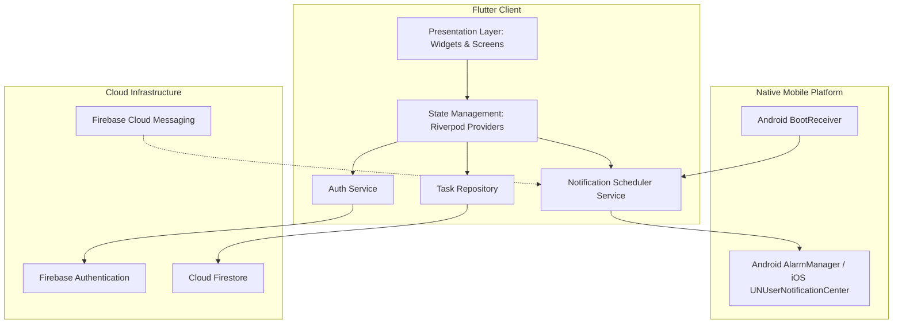
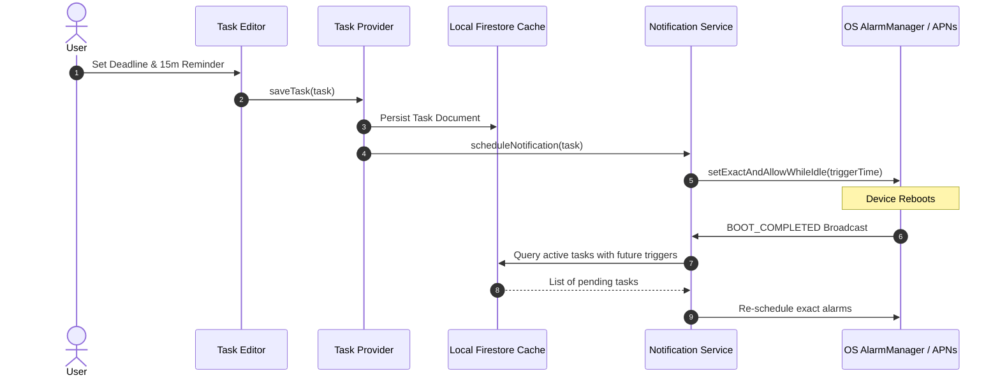

# Todo Mobile Application

*   **Author:** Mobile Engineering Team
*   **Status:** Draft
*   **Date:** 2025-05-18

--------------------------------------------------------------------------------

## Overview

The Todo Mobile Application is a mobile-first task management application built with Flutter, designed to help individuals capture, structure, and track tasks reliably across iOS and Android. The application emphasizes immediate access and high reliability through an offline-first architecture, an instant Guest Mode that defers authentication, granular check-pointed subtasks, and exact-alarm local notifications that fire regardless of network connectivity or operating system background throttling. When connected, tasks synchronize seamlessly across devices via Cloud Firestore.

## The Problem

Modern task management applications frequently fail users in high-mobility and low-connectivity environments:

1. **Connectivity Dependencies**: Cloud-reliant apps fail to load or accept input in offline scenarios (such as transit, remote areas, or flight mode). Furthermore, remote push notifications (FCM/APNs) fail to trigger deadline alerts when a device is offline.
2. **Onboarding Friction**: Forcing immediate registration and account creation introduces high drop-off before users experience the app's core utility.
3. **Fragile Local Solutions**: Local-only task apps protect privacy and operate offline, but lack data durability; users risk catastrophic data loss on device replacement, loss, or factory reset.
4. **Monolithic Task Representation**: Basic todo apps lack structured breakdown mechanisms, forcing users to clutter main task lists with micro-items or track intermediate sub-steps externally.
5. **Notification Unreliability**: Mobile operating systems (Android Doze, iOS background execution restrictions) aggressively throttle standard background tasks, causing missed deadlines unless exact system alarm APIs and reboot recovery mechanisms are utilized.

The Todo Mobile Application addresses these problems by offering zero-friction instant onboarding in Guest Mode, offline-first local persistence, check-pointed subtask checklists, and exact hardware-level notifications, backed by seamless cloud sync and account linking.

## Goals

* **Instant Guest Onboarding**: Allow users to immediately launch the app and create tasks without an initial signup or authentication barrier.
* **Offline-First Persistence**: Ensure 100% of task operations (create, read, update, delete, complete, and archive) work seamlessly without an active internet connection.
* **Structured Subtask Checkpoints**: Enable users to break down complex tasks into ordered subtask checklists with live visual progress indicators (e.g., "3 of 5 completed").
* **Reliable Offline Deadline Reminders**: Provide exact, local deadline notifications with user-configurable lead times (e.g., at deadline, 15 minutes before, 60 minutes before) that fire reliably offline and persist across device reboots.
* **Decluttering via Task Archiving**: Allow users to archive completed or inactive tasks to preserve historical records while keeping the primary workspace focused.
* **Seamless Cloud Synchronization & Account Linking**: Automatically sync tasks to Cloud Firestore when online, allowing guest users to link their session to an authenticated identity (Email/Password or Social OAuth) with zero data loss.

## Non-Goals

* **Collaboration & Shared Boards**: No multi-user shared task boards, team assignments, or collaborative editing in the MVP.
* **Advanced Recurring Scheduling**: No support for complex recurring recurrence rules (RRULE patterns, e.g., "every second Tuesday of the month").
* **Natural Language Processing (NLP)**: No natural language input parsing for automated date/priority extraction (e.g., "Buy groceries tomorrow at 5pm").
* **Web and Desktop Targets**: Deployment is strictly focused on native mobile targets (iOS and Android); web and desktop clients are out of scope for the MVP.
* **Deeply Nested Task Hierarchies**: Subtasks are restricted to a single-level checklist; recursive parent-child task nesting is not supported.

## Critical User Journeys (CUJs)

```yaml
- user: Individual Mobile User
  goals:
  - goal: Onboard and capture urgent tasks without friction
    tasks:
    - task: Instant guest access and task creation
      scenario:
        given: A newly installed application opened for the first time without an existing account.
        when: The user launches the app and creates a High-priority task with a due date and a 60-minute advance reminder.
        then: The task is saved locally immediately in Guest Mode, and an exact local alarm is scheduled without prompting for signup.
    - task: Subtask breakdown and progress tracking
      scenario:
        given: An active parent task with multiple action items.
        when: The user adds three subtasks and marks two of them as completed.
        then: The subtasks persist in order, and the parent task displays a visual progress indicator reflecting "2 of 3 completed".
  - goal: Manage active task decluttering and lifecycle
    tasks:
    - task: Archiving and unarchiving tasks
      scenario:
        given: A finished or deferred task present on the active dashboard.
        when: The user executes an archive action on the task.
        then: The task is removed from the active view, placed in the dedicated Archive view, and can later be unarchived back to active status without data loss.
  - goal: Retain data and access tasks across devices
    tasks:
    - task: Seamless guest account linking
      scenario:
        given: A guest user with existing local tasks who wants to enable multi-device sync.
        when: The user navigates to Settings and completes account linking using Google Sign-In or Email/Password.
        then: All existing guest tasks and subtasks are associated with the authenticated account in Cloud Firestore with zero data loss.
    - task: Timely deadline alert delivery in offline mode
      scenario:
        given: A scheduled task with a reminder set 15 minutes prior to the deadline, with device offline and app killed.
        when: The scheduled alert time arrives.
        then: The operating system triggers an exact local notification banner; tapping it launches the app directly into the task details screen.
    - task: Multi-device state synchronization
      scenario:
        given: An authenticated user with the app installed on two devices (Device A and Device B).
        when: The user completes a subtask and archives a task on Device A while offline, then Device A reconnects.
        then: Changes synchronize to Cloud Firestore using Last-Write-Wins (LWW), and Device B updates its list and cancels any associated obsolete alarms.
```

--------------------------------------------------------------------------------

## Technical Plan (Architecture)

### 1. High-Level System Architecture

The application is structured into four primary layers:
1. **Presentation Layer (Flutter UI)**: Renders the task dashboard, subtask checklist components, archive view, and account linking interfaces.
2. **Domain & State Management Layer (Riverpod)**: Maintains reactive view state, manages task business logic, calculates checklist progress metrics, and coordinates repository calls.
3. **Data & Synchronization Layer**: Encapsulates Firestore SDK local cache persistence, offline change queueing, and network synchronization.
4. **Native Platform Services**: Coordinates exact offline hardware alarms via native platform bindings (`AlarmManager` on Android, `UNUserNotificationCenter` on iOS) and listens to system lifecycle events (such as `BOOT_COMPLETED`).



### 2. Data Models and Firestore Schema

Data is isolated per user under the path `/users/{userId}/tasks/{taskId}`. Tasks embed their subtasks directly within the task document to guarantee atomic updates and simple Last-Write-Wins synchronization.

#### Task Document Schema (`/users/{userId}/tasks/{taskId}`)
```typescript
interface TaskDocument {
  id: string;                         // UUIDv4 unique identifier
  userId: string;                     // Firebase Auth UID (anonymous or authenticated)
  title: string;                      // Task title (non-empty)
  description: string;                // Detailed description (optional, markdown-supported)
  priority: 'low' | 'medium' | 'high';// Task priority (defaults to 'medium')
  isCompleted: boolean;               // Task completion status
  isArchived: boolean;                // Archive state (true = in archive, false = active)
  deadline: string | null;            // ISO-8601 UTC string (e.g., "2025-05-20T14:00:00Z")
  reminderLeadTimeMinutes: number | null; // Lead time in minutes (0, 15, 60, or null)
  subtasks: Subtask[];                // Embedded ordered checklist items
  createdAt: string;                  // ISO-8601 UTC timestamp
  updatedAt: string;                  // ISO-8601 UTC timestamp (used for LWW resolution)
}

interface Subtask {
  id: string;                         // UUIDv4 unique identifier within task
  title: string;                      // Checklist item title
  isCompleted: boolean;               // Subtask completion state
  order: number;                      // Display sequence index
}
```

#### Schema Design Rationale
- **Embedded Subtasks**: Nesting subtasks inside the parent task document prevents multi-document distributed transaction overhead, eliminates Firestore N+1 subcollection read costs, and ensures parent progress indicators ("3 of 5 completed") are computed synchronously in memory.
- **Top-level Indexing**: Compound indexes on `(userId, isArchived, priority, deadline)` allow fast filtered queries for active tasks vs. archived tasks sorted by deadline or priority.

### 3. Core Component Workflows

#### A. Guest Mode & Account Linking Lifecycle
1. **Initial Boot**: The app checks Firebase Auth. If no user exists, `signInAnonymously()` is executed silently. An anonymous `userId` is minted.
2. **Local Work**: All task CRUD operations execute against `/users/{userId}/tasks/{taskId}` using local Firestore persistence.
3. **Account Upgrade**:
   - The user selects "Link Account" in Settings.
   - The app acquires permanent credentials (via `GoogleAuthProvider.credential()` or `EmailAuthProvider.credential()`).
   - The app calls `currentUser.linkWithCredential(credential)`.
   - The user ID remains identical (`userId` is retained), automatically maintaining data ownership in Firestore without data migration or re-indexing.

```mermaid
sequenceDiagram
    autonumber
    actor User
    participant App as Flutter App
    participant Auth as Firebase Auth
    participant DB as Cloud Firestore

    User->>App: Launch App First Time
    App->>Auth: signInAnonymously()
    Auth-->>App: Anonymous User (UID: guest_123)
    User->>App: Create Tasks & Subtasks
    App->>DB: Write to /users/guest_123/tasks/...
    DB-->>App: Cached locally & synced

    Note over User, App: Later: User chooses to link account
    User->>App: Link Account (Google / Email)
    App->>Auth: linkWithCredential(credential)
    Auth-->>App: Upgraded User (Retained UID: guest_123)
    Note over App, DB: UID preserved; Firestore documents remain intact
```

#### B. Offline-First Notification Engine & Reboot Recovery
1. **Scheduling**:
   - When a task has a `deadline` and `reminderLeadTimeMinutes`, the trigger time is calculated: `triggerTime = deadline - reminderLeadTimeMinutes`.
   - `NotificationService` calls `flutter_local_notifications` to schedule an exact alarm with Android `AlarmManager.setExactAndAllowWhileIdle()` and iOS `UNNotificationRequest`.
   - The notification payload includes `{ taskId: task.id }`.
2. **Task Completion / Archival**:
   - Marking a task completed or archived immediately invokes `NotificationService.cancel(task.id)` to prevent stale alerts.
3. **Reboot Recovery**:
   - An Android `BroadcastReceiver` listening to `android.intent.action.BOOT_COMPLETED` is registered in `AndroidManifest.xml`.
   - Upon system boot, the receiver invokes a background Dart entry point that queries active, uncompleted tasks with pending deadlines from Firestore's local cache and reschedules the exact alarms with the OS.



#### C. Synchronization & Conflict Handling
- Firestore automatically maintains an offline mutation queue. Read operations prioritize local cache when offline.
- When network connectivity is restored, writes are sent upstream with an `updatedAt` server timestamp.
- **Last-Write-Wins (LWW)**: Conflicts resolve by timestamp comparison. Subtasks being embedded in the task document ensures that checklist toggles are atomic mutations on the task record.
